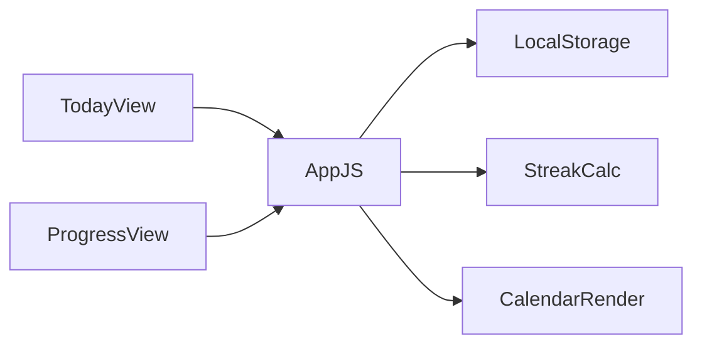

# Identity Habit Tracker — Design

Personal identity-based habit tracker. The win condition is **starting** each daily habit, not completing a timed session. Philosophy: “just begin” (shoes on, book open, scripture open) — consistency over duration.

**Stack:** Single-page local app — `index.html`, `styles.css`, `app.js`. No backend, no build step, no notifications. Data in `localStorage`.

## Architecture



- **Today view:** Six identity rows; tap to mark started for today.
- **Progress view:** Per-identity streaks + month calendar of past starts.
- **Day boundary:** Local midnight; dates keyed as `YYYY-MM-DD`.

## Identities (fixed in v1)

| ID | Identity title | Subtitle | Daily start | Soft duration |
|----|----------------|----------|-------------|---------------|
| workout | Someone who works out | Healthy lifestyle | Workout | ~30 min |
| reading | Someone who learns | Reads and grows | Reading | ~30 min |
| music | Someone who makes music | Practice and improve | Music practice | ~30 min |
| professional | Someone professionally ready | Career readiness | Resume / professional work | ~30 min |
| disciple | Disciple of Jesus Christ | — | Scripture study | ~45 min |
| family | Good husband & father | Someone in control | Reflection | ~20 min |

Durations are display-only guidance. No timer. Checking toggles (can uncheck mistakes).

## Data model

```json
{
  "completions": {
    "2026-07-30": {
      "workout": true,
      "reading": true,
      "music": false,
      "professional": true,
      "disciple": true,
      "family": true
    }
  }
}
```

- Identities hardcoded in JS.
- Streak per identity: consecutive days ending today, or yesterday if today is still incomplete for that habit.
- “Full day” streak: consecutive days where all six were started.

## UI

**Today**

- Header with product framing (identity / becoming), today’s date, count “X of 6 started.”
- List of identity cards: title, subtitle, task + soft duration, large start checkbox.
- Checked state clearly “started” — not “completed for 30 minutes.”
- Simple Today / Progress navigation.

**Progress**

- Streak chips per identity + full-day streak.
- Month calendar; select an identity (or “all”) to see start days highlighted.
- Prev/next month navigation.

**Visual direction (v1):** Calm, grounded personal tool — clear type hierarchy, soft atmospheric background (not flat white), identity language primary over task jargon. No purple-gradient cliché; no notification chrome.

## Error handling & edge cases

- Corrupt / missing `localStorage`: reset to empty completions; app still usable.
- Quota / write failure: show a brief inline message; keep in-memory state for the session.
- Future dates: not creatable; only today is writable; history is read-only.
- No sync across browsers/devices (accepted for local-only).

## Out of scope (v1)

- Editing / adding identities
- Timers, reminders, notifications
- Auth, Firebase, multi-device sync
- Export/import (nice-to-have later)
- Accounts or multi-user

## Testing (manual)

- Check/uncheck each habit; reload page — state persists.
- Streak increments across midnight (or simulated date).
- Calendar shows correct past days; month navigation works.
- Clear `localStorage` — app recovers to empty day.
